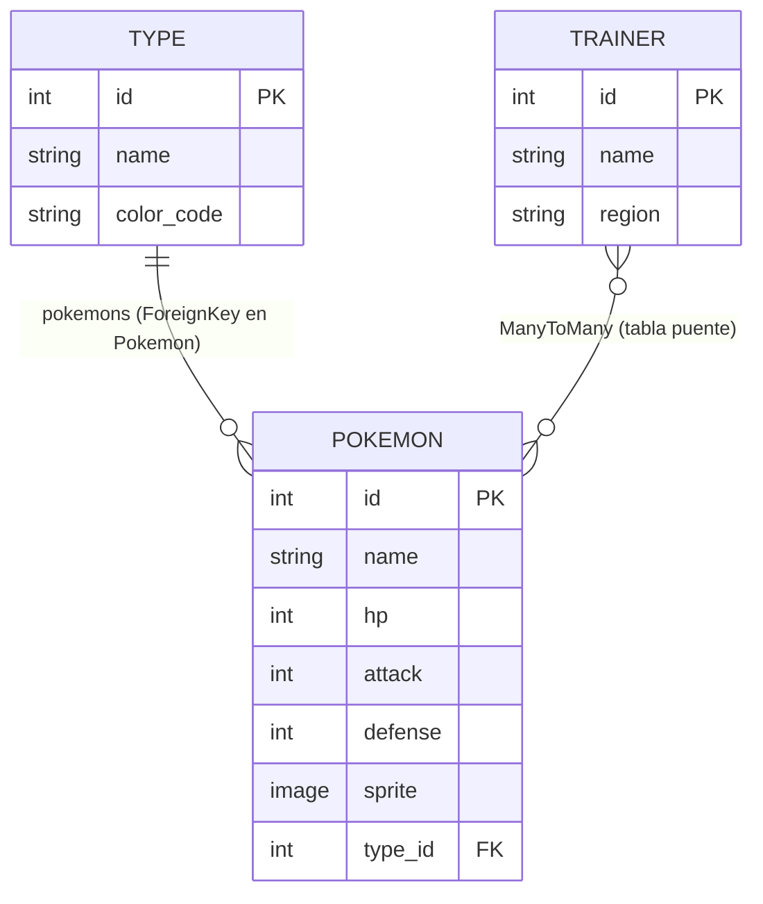

# 🎒 Proyecto PokeDex: Aprendiendo Arquitectura Backend y APIs

¡Bienvenido, futuro desarrollador! 👋 En este laboratorio construirás una **PokeDex**: un catálogo de Pokémon, sus tipos y los entrenadores que los capturan.

Pero el verdadero objetivo no es la PokeDex, sino **entender cómo evoluciona el desarrollo web**:

| Modelo tradicional (monolito) | Arquitectura desacoplada (API REST) |
|---|---|
| Django genera el HTML y lo entrega ya armado. | Django solo expone **datos en JSON** a través de una API. |
| Backend y vista viven en el mismo proyecto. | **React** consume la API de forma independiente. |
| Cambiar la interfaz implica tocar el servidor. | Frontend y backend evolucionan por separado. |

> 💡 **Nota de aprendizaje:** Piensa en un restaurante. En el modelo monolítico, la cocina te entrega el plato ya servido en la mesa. En una arquitectura con API, la cocina (backend) entrega los platos por una ventanilla estandarizada (la API) y cualquier mesero (web, móvil, otra app) puede llevarlos al cliente.

**Stack tecnológico**

- **Backend:** Django 5.2 LTS + Django REST Framework, Pillow (imágenes) y JWT (autenticación).
- **Frontend:** React + Vite, Axios (peticiones HTTP) y Material UI (componentes).
- **Base de datos:** PostgreSQL 17, administrable con pgAdmin.
- **Infraestructura:** Docker Compose. **No necesitas instalar Python, Node ni PostgreSQL en tu equipo.**

---

## 📚 Índice y documentación

**Guías por módulo** (cada una tiene sus propios comandos, laboratorios y problemas frecuentes):

| Módulo | Guía | Qué encontrarás |
|---|---|---|
| ⚙️ Backend (Django) | [backend/README.md](./backend/README.md) | Ruta de aprendizaje (MVT/MVC → ORM → DRF → OAuth 2.0 y JWT), comandos de Django con Docker, base de datos y pgAdmin. |
| 🎨 Frontend (React + Vite) | [frontend/README.md](./frontend/README.md) | Laboratorios 9–11 (componentes, Axios, autorización), comandos de npm con Docker. |

**Contenido de esta guía general**

1. [Inicio rápido con Docker](#-inicio-rápido-solo-necesitas-docker)
2. [Entendiendo el modelo de datos](#-entendiendo-el-modelo-de-datos-el-porqué-de-las-relaciones)
3. [Estructura del modelo de datos](#️-estructura-del-modelo-de-datos-campos-técnicos)
4. [Mapa de relaciones visual](#-mapa-de-relaciones-visual)
5. [Organización del repositorio](#-organización-del-repositorio)

> 💡 **Nota de aprendizaje:** Este README explica el **qué y el porqué** (conceptos y arquitectura). Los README de backend y frontend explican el **cómo** (comandos y laboratorios).

---

## 🐳 Inicio rápido (solo necesitas Docker)

### 1. Instalación y arranque

1. Instala [Docker Desktop](https://www.docker.com/products/docker-desktop/) (Windows / macOS) o Docker Engine + Compose (Linux).
2. En la raíz del repositorio ejecuta `docker compose up --build`:

```bash
docker compose up --build
```

### 2. Servicios disponibles

| Servicio | URL | Credenciales |
|---|---|---|
| Frontend (React + Vite) | <http://localhost:5173> | — |
| Backend (Django) | <http://localhost:8000> | — |
| pgAdmin | <http://localhost:5050> | `admin@pokedex.com` / `admin` |

**Conectar pgAdmin a la base de datos:** *Add New Server* → Host `db`, Puerto `5432`, Base de datos `pokedex`, Usuario `pokedex`, Contraseña `pokedex`.

### 3. Red de contenedores

Todos los contenedores comparten la red **`pokedex_framework`**, por eso se encuentran entre sí por nombre (`db`, `backend`, `frontend`, `pgadmin`).

> 💡 **Nota de aprendizaje:** Dentro de la red de Docker, el backend llega a la base de datos usando el host `db` y **no** `localhost`. Dentro de un contenedor, `localhost` es el propio contenedor.

### 4. Comandos de uso diario

```bash
docker compose up -d              # Levantar todo en segundo plano
docker compose logs -f backend    # Ver los logs del backend
docker compose down               # Apagar (conserva los datos)
docker compose down -v            # Apagar y BORRAR la base de datos
```

Los comandos específicos de cada parte están en [backend/README.md](./backend/README.md#ejecutar-comandos-de-django) y [frontend/README.md](./frontend/README.md#comandos-útiles-con-docker-compose).

---

## 🧠 Entendiendo el Modelo de Datos (El porqué de las relaciones)

Antes de escribir una sola línea de código, pensemos como diseñadores de bases de datos. Una buena base de datos **no repite información**: cada dato vive en un solo lugar y los demás lo referencian.

### 🔥 La relación Uno a Muchos (One-to-Many): Tipos y Pokémon

Imagina una biblioteca. El género **"Fuego"** es una *estantería* y cada Pokémon es un *libro* que se coloca en una sola estantería.

- **Fuego** es una *categoría madre*.
- **Charmander** nace con **un único tipo principal**: Fuego.
- Pero la categoría Fuego cobija a **muchísimos** Pokémon: Vulpix, Ponyta, Growlithe...

**Uno** (un Tipo) → **Muchos** (Pokémon).

Si no usáramos una relación, cada Pokémon repetiría los datos del tipo:

```text
❌ Sin relación (datos repetidos)           ✅ Con relación (un solo lugar)
─────────────────────────────────           ─────────────────────────────
Charmander | Fuego | #F08030                Tipo:    1 | Fuego | #F08030
Vulpix     | Fuego | #F08030                Pokémon: Charmander → tipo 1
Ponyta     | Fuego | #F08030                         Vulpix     → tipo 1
                                                      Ponyta     → tipo 1
```

Si mañana cambias el color de Fuego, ¡solo editas **una fila**!

> 💡 **Nota de aprendizaje:** A esto se le llama **normalización**. Evita redundancia, ahorra espacio y previene inconsistencias (por ejemplo, que un Pokémon diga "Fuego" y otro "fuego").

En Django esto se logra con una **`ForeignKey`** (llave foránea) puesta en el lado de los "muchos", es decir, en el Pokémon. Con `related_name='pokemons'` además puedes **mirar la relación a la inversa**: desde el Tipo hacia sus criaturas.

```python
fuego = Type.objects.get(name="Fuego")
fuego.pokemons.all()   # → Charmander, Vulpix, Ponyta...
```

### 🎒 La relación Muchos a Muchos (Many-to-Many): Entrenadores y Pokémon

Aquí aparece el dilema:

- Un entrenador puede atrapar y registrar **muchos** Pokémon en su equipo.
- Pero la especie **Pikachu** no le pertenece a un solo entrenador: ¡puede ser capturada por **miles** de entrenadores en el mundo!

Ya no hay un "lado de los muchos" claro: **ambos lados son muchos**. Una `ForeignKey` simple no alcanza.

Los motores de bases de datos lo resuelven con una **tabla intermedia (o "puente")**, que guarda parejas *(entrenador, pokémon)*:

```text
Entrenador          Tabla puente                 Pokémon
──────────          ────────────────────         ─────────
1 Ash        ───►   Ash   ↔ Pikachu      ◄───    Pikachu
2 Misty      ───►   Ash   ↔ Charmander   ◄───    Charmander
                    Misty ↔ Pikachu
                    Misty ↔ Staryu
```

> 💡 **Nota de aprendizaje:** Piensa en la tabla puente como una *lista de asistencia*: cada renglón dice "este entrenador tiene a este Pokémon". Nadie pierde su identidad; solo se registran las conexiones.

Lo mejor: **Django crea y administra esa tabla por ti** con un simple `ManyToManyField`. Con `related_name='trainers'` puedes preguntar a la inversa:

```python
ash.pokemons.all()           # Pokémon de Ash
pikachu.trainers.all()       # Entrenadores que tienen a Pikachu
```

---

## 🗂️ Estructura del Modelo de Datos (Campos Técnicos)

Ahora que entendemos el *porqué*, aterricemos al ORM de Django. Estos son los tres modelos del laboratorio:

### `Type`

| Campo | Tipo Django | Descripción |
|---|---|---|
| `name` | `CharField` | Nombre del tipo (Fuego, Agua...). |
| `color_code` | `CharField` | Código hexadecimal (ej. `#F08030`). **El frontend lo usará para pintar la interfaz dinámicamente**, sin colores escritos a mano en React. |

### `Pokemon`

| Campo | Tipo Django | Descripción |
|---|---|---|
| `name` | `CharField` | Nombre del Pokémon. |
| `hp` | `PositiveIntegerField` | Puntos de vida. |
| `attack` | `PositiveIntegerField` | Poder de ataque. |
| `defense` | `PositiveIntegerField` | Poder de defensa. |
| `sprite` | `ImageField` | Imagen del Pokémon, gestionada por **Pillow**. |
| `type` | `ForeignKey(Type, related_name='pokemons')` | Tipo elemental principal. |

### `Trainer`

| Campo | Tipo Django | Descripción |
|---|---|---|
| `name` | `CharField` | Nombre del entrenador. |
| `region` | `CharField` | Región de origen (Kanto, Johto...). |
| `pokemons` | `ManyToManyField(Pokemon, related_name='trainers')` | Equipo de Pokémon capturados. |

```python
class Type(models.Model):
    name = models.CharField(max_length=50)
    color_code = models.CharField(max_length=7)

class Pokemon(models.Model):
    name = models.CharField(max_length=100)
    hp = models.PositiveIntegerField()
    attack = models.PositiveIntegerField()
    defense = models.PositiveIntegerField()
    sprite = models.ImageField(upload_to='sprites/')
    type = models.ForeignKey(Type, on_delete=models.CASCADE, related_name='pokemons')

class Trainer(models.Model):
    name = models.CharField(max_length=100)
    region = models.CharField(max_length=50)
    pokemons = models.ManyToManyField(Pokemon, related_name='trainers')
```

> 💡 **Nota de aprendizaje:** `ImageField` **no guarda la imagen en la base de datos**; guarda solo la *ruta* del archivo (por ejemplo `sprites/pikachu.png`). El archivo vive en la carpeta `MEDIA_ROOT`. Pillow es la librería que valida que el archivo realmente sea una imagen.

> ⚠️ **Ojo:** `on_delete=models.CASCADE` significa que, si borras un Tipo, se borran sus Pokémon. Investiga qué otras opciones existen (`PROTECT`, `SET_NULL`) y discute en clase cuál conviene.

---

## 📐 Mapa de Relaciones Visual



Versión en texto plano:

```text
 ┌────────┐ 1                    N ┌─────────┐ N                 N ┌─────────┐
 │  Type  │ ◄───────────────────── │ Pokemon │ ◄───[ puente ]───► │ Trainer │
 └────────┘   type_id (ForeignKey) └─────────┘  tabla intermedia   └─────────┘
   .pokemons  (acceso inverso)                   .trainers / .pokemons
```

> 💡 **Nota de aprendizaje:** La flecha de la llave foránea apunta **desde el Pokémon hacia el Tipo**: quien tiene la columna `type_id` es el Pokémon, porque es el lado de los "muchos".

---

## 🚀 Organización del Repositorio

```text
pokedex/
├── docker-compose.yml        # Orquesta db, pgadmin, backend y frontend
├── README.md                 # Esta guía
│
├── backend/                  # API con Django 5.2
│   ├── Dockerfile
│   ├── manage.py
│   ├── requirements.txt      # Dependencias congeladas (Django, DRF, Pillow, JWT, psycopg...)
│   ├── README.md
│   └── pokedex/              # Proyecto Django (settings.py, urls.py...)
│
└── frontend/                 # Cliente con React + Vite
    ├── Dockerfile
    ├── package.json          # React, Axios, Material UI
    ├── vite.config.js
    ├── README.md
    └── src/                  # Componentes, páginas y servicios (Axios)
```

> 💡 **Nota de aprendizaje:** Un **monorrepo** guarda backend y frontend en un mismo repositorio. Es cómodo para aprender: un solo `docker compose up` levanta todo el ecosistema.

➡️ **Siguiente paso:** continúa con la [guía del backend](./backend/README.md) y luego con la [guía del frontend](./frontend/README.md).

¡Mucho éxito y a disfrutar el viaje! 🚀
